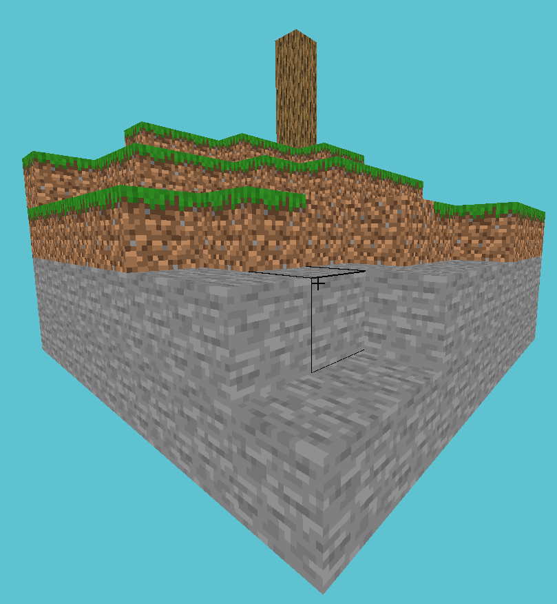

# 3D Voxel Game

A 3D voxel game inspired by Minecraft, developed using Python, Pygame-CE, and OpenGL.

EXE file is in the [Here](https://drive.google.com/drive/folders/1F2cAMhvpaIxljQxVqn1ASc5JZA8FIVu1?usp=sharing)

This project was created purely for learning and experimentation. It is a personal project and is not intended for commercial distribution.

## Screenshots



*This terrain was built entirely by hand. The game does not currently support procedural terrain generation.*

## Features

- **3D Voxel Rendering** - Render textured voxel blocks using OpenGL.
- **Block Interaction** - Break and place blocks.
- **Block Entities** - Broken blocks turn into small falling cube entities affected by gravity.
- **Player Movement** - First-person movement with jumping and gravity.
- **Collision Detection** - Collision detection between the player, blocks, and entities.
- **Raycasting** - DDA-based raycasting to detect blocks in the player's line of sight.
- **Texture System** - Different textures for different block types and faces.
- **Block Selection** - Highlight the block currently being targeted.

## Technologies Used

- Python
- Pygame-CE
- PyOpenGL
- OpenGL

## Controls

| Input | Action |
|:---|:---|
| W | Move forward |
| A | Move left |
| S | Move backward |
| D | Move right |
| Mouse | Look around |
| Space | Jump |
| Left Mouse Button | Break a block |
| Right Mouse Button | Place a block |
| 1–9 | Select inventory slot |
| Esc | Exit the game |

## Installation

### Requirements

- Python
- Pygame-CE
- PyOpenGL

### Setup

Install the required packages:

```bash
pip install pygame-ce PyOpenGL
```

Clone this repository:

```bash
git clone https://github.com/koyoung1457-sketch/voxel_game
```

Navigate to the project directory and run:

```bash
python main.py
```

## Project Structure

```text
.
├── main.py          # Main game loop and event handling
├── player.py        # Player movement, physics, and inventory
├── camera.py        # Camera settings
├── world.py         # World and block management
├── block.py         # Block class
├── blocks.py        # Block types and texture definitions
├── entity.py        # Block entity physics and collision
├── raycast.py       # DDA-based raycasting
├── rendering.py     # OpenGL rendering
├── texture.py       # Texture loading and management
├── rect3.py         # 3D collision rectangles
├── math3.py         # 3D mathematical operations
├── textures/        # Block textures
└── images/          # README images
```

## Development Status

This project is currently under development.

More features and improvements may be added in the future.
